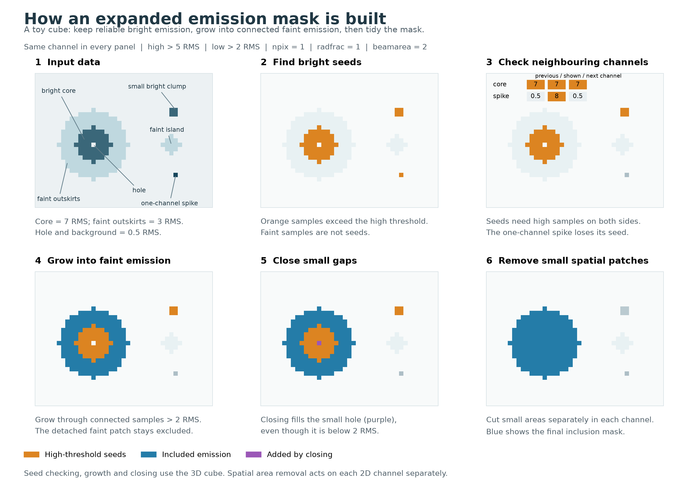

# SpectralCubePlus

SpectralCubePlus adds noise estimation, emission masking, and moment-map uncertainty products to [SpectralCube](https://spectral-cube.readthedocs.io/). It is intended for spectral-line cubes where you want to estimate noise along each sightline, select connected emission, and measure integrated intensity with an uncertainty map.

The package provides:

- **Spatial noise maps:** Gaussian-scaled median absolute deviation (MAD) from selected line-free intervals, or an automatic estimate using negative samples and clipping.
- **Expanded emission masks:** grow high signal-to-noise seeds into connected lower signal-to-noise emission, close gaps, and remove small spatial components.
- **Beam-smoothed detection:** build a mask at a larger beam size and apply it to the original cube for full-resolution moments.
- **Moment products:** use inherited SpectralCube methods, or obtain a dictionary of FITS moments, noise references, and signal-to-noise maps.
- **Moment-zero uncertainties:** propagate one RMS value per sightline using the actual number of finite, included channels.

These helpers supplement SpectralCube's reading, unit conversion, slicing, masking, and writing methods. They do not choose line-free channels or scientifically appropriate mask settings for you.

## Installation

```bash
git clone https://github.com/ashleythomasbarnes/spectral_cube_plus.git
cd spectral_cube_plus
pip install .
```

Package metadata declares Python 3.7+ and dependencies on `spectral-cube`, `radio-beam`, `astropy`, `numpy`, `scipy`, and `matplotlib`. Compatible dependency versions must also support your Python version.

## A complete workflow

Cube arrays use **(spectral, y, x)** order. Spatial maps use **(y, x)**. Boolean masks use `True` for included samples.

This example assumes a common-beam cube whose spectral axis is already a velocity axis. Prepare units and any cutouts before estimating noise.

```python
from astropy import units as u
from astropy.io import fits
from spectral_cube_plus import SpectralCubePlus

cube = SpectralCubePlus.read("path/to/your/file.fits")
cube = cube.with_spectral_unit(u.km / u.s)
# Optional: cube = cube.to(u.K)  # Requires suitable brightness/beam metadata.

# Estimate noise before applying an emission mask.
rms = cube.get_rms_auto()
# Alternative: choose line-free intervals appropriate to your data.
# rms = cube.get_rms([[0, 5], [20, 25]] * u.km / u.s)

expmask = cube.get_expmask(
    hthresh=5, lthresh=2, beamarea=2, radfrac=1, npix=1,
)
masked = cube.masked
moment0 = masked.moment0()
moment0_error = masked.moment0err()

# Save each product explicitly. Masks have no physical brightness unit.
cube.rms_hdu.writeto("rms.fits", overwrite=True)
mask_header = cube.header.copy()
mask_header["BUNIT"] = ""
fits.PrimaryHDU(expmask.astype("uint8"), header=mask_header).writeto(
    "expmask.fits", overwrite=True,
)
masked.writeto("masked_cube.fits", overwrite=True)
moment0.write("moment0.fits", overwrite=True)
moment0_error.write("moment0_error.fits", overwrite=True)
```

The saved mask contains 1 for included samples and 0 for excluded samples. The masked cube writer uses SpectralCube's masked-data representation; it does not bundle the boolean mask, RMS, or moment products as extra FITS extensions. The examples overwrite the named output files.

For a **frequency axis**, conversion to velocity needs the line rest frequency and a velocity convention. Define `rest_frequency` as the correct frequency Quantity for your line, then replace the conversion above with:

```python
cube = cube.with_spectral_unit(
    u.km / u.s, velocity_convention="radio", rest_value=rest_frequency,
)
```

The data need not be in Kelvin: RMS retains the cube's data unit, and spectral moment zero has that unit multiplied by the current spectral-axis unit.

## Build a mask from a spatially smoothed cube

Use `smooth_factor` to multiply both original beam FWHM axes while retaining its position angle. For example, a factor of 2 changes a 3-by-2 arcsec beam to a 6-by-4 arcsec beam. The package uses `radio_beam.Beam` and SpectralCube's [beam-aware convolution](https://spectral-cube.readthedocs.io/en/latest/smoothing.html#spatial-smoothing); the pixel grid and spectral axis stay unchanged.

```python
cube.get_expmask(smooth_factor=2, hthresh=5, lthresh=2)
moment0 = cube.masked.moment0()
moment0_error = cube.masked.moment0err()

# Detection products use the larger beam.
cube.mask_cube.rms_hdu.writeto("smoothed_rms.fits", overwrite=True)
# Native RMS remains the uncertainty reference for full-resolution moments.
cube.rms_hdu.writeto("native_rms.fits", overwrite=True)
```

Each smoothed-mask call automatically estimates fresh detection RMS from the smoothed cube, even if native RMS is already stored. Native RMS is reused, or estimated automatically from the original cube if missing. Thresholding, area pruning, and closing use the detection cube's RMS and beam. The resulting boolean mask is applied to the original data, respecting their existing mask and invalid samples. `cube.masked` retains the original beam and intensities, including for Jy/beam cubes; its uncertainties use native RMS. `cube.mask_cube` exposes the latest detection cube and its separate RMS products.

Without smoothing, `get_expmask()` uses an explicit `rms` map, otherwise reuses `cube.rms`, or estimates RMS automatically if none exists:

```python
cube.get_expmask(rms=my_native_rms, hthresh=5, lthresh=2)
```

An explicit RMS may be a compatible Quantity, Projection, or FITS image HDU. The method stores it in native units with a corresponding RMS HDU. Supplying both `rms` and `smooth_factor` raises `ValueError`. Factors must be finite numbers >= 1; factor 1 skips convolution but still recomputes detection RMS. Each call prints the RMS source and its finite median/range with units, or reports no finite values. Automatic estimation uses the existing `get_rms_auto` prescription and assumptions. Smoothing adds a working cube and can increase memory use; use suitable cutouts for large datasets.

## Class methods and stored products

`SpectralCubePlus` is imported from `spectral_cube_plus`. Its added methods operate on the object you call them on. Computing an expanded mask does not change the original cube's mask: use `cube.masked` for emission-selected measurements.

| Method | Inputs | Return value | Stored products |
| --- | --- | --- | --- |
| `read(filename, *args, **kwargs)` | Input and options accepted by `SpectralCube.read`, including `use_dask=True` | `SpectralCubePlus`, with a Dask subclass when requested | Derived products start empty |
| `get_rms(rms_velocities, mask=None)` | One or more spectral intervals; optional additional inclusion mask | `(y, x)` RMS `Quantity` in the data unit | `rms`, `rms_hdu`; clears cached `mom0err` |
| `get_rms_auto(mask=None)` | Optional additional inclusion mask | `(y, x)` RMS `Quantity` in the data unit | `rms`, `rms_hdu`; clears cached `mom0err` |
| `get_expmask(*args, rms=None, smooth_factor=None, **kwargs)` | Mask settings below; explicit/stored/automatic RMS, optional beam factor | `(spectral, y, x)` boolean array | `expmask`, `masked`, `mask_cube`, native `rms`/`rms_hdu`; attaches native RMS to `masked` and detection RMS to `mask_cube` |
| `moment0(axis=0, how="auto", **kwargs)` | Integration axis and upstream moment options | Integrated `Projection` | Caches `mom0` only for spectral integration (`axis=0`) |
| `moment0err(rms=None)` | Explicit aligned RMS, or stored `rms` | `(y, x)` uncertainty `Projection` in moment-zero units | `mom0err` |
| `writeto(filename, *args, **kwargs)` | Options accepted by the inherited writer | Upstream writer result, normally `None` for FITS | Writes this cube only |

`rms_hdu` is a `PrimaryHDU` containing numeric RMS values, celestial WCS, `BUNIT`, and available beam keywords. `mom0err` is a cached product attribute; `moment0err()` is the callable method.

Transformations such as `with_mask`, `spectral_slab`, `to`, and `with_spectral_unit` create new cube instances and reset derived state. Estimate RMS after preparing your cube, or pass an aligned map explicitly:

```python
slab = masked.spectral_slab(10 * u.km / u.s, 20 * u.km / u.s)
slab_error = slab.moment0err(rms=cube.rms_hdu)
```

Here the spatial grid and data unit remain suitable for the original RMS map. If you change either, supply a matching noise map. Re-estimating RMS does not regenerate an existing expanded mask or update its attached masked cube; rerun `get_expmask` when those products need refreshing.

## Estimating noise

### Explicit line-free intervals

`get_rms` accepts a single pair `(2,)` or a collection `(N, 2)` of finite, ordered bounds. Bounds select channel centres inclusively; overlaps count each channel once. Descending spectral axes are supported. An interval union containing no channel centres raises `ValueError`.

```python
rms = cube.get_rms([0, 5] * u.km / u.s)
rms = cube.get_rms([[0, 5], [20, 25]] * u.km / u.s)
# Numeric bounds use cube.spectral_axis.unit, whatever that unit is.
rms = cube.get_rms([[0, 5], [20, 25]])
```

The result is Gaussian-scaled MAD, not a root-mean-square about zero. Existing masked samples and nonfinite values are ignored. Sightlines with no usable samples have NaN noise values. An additional `mask=` is combined with the existing mask only for noise estimation and does not change the original cube's mask. Choose noise channels before applying an emission-only mask.

### Automatic estimate

`get_rms_auto()` starts with Gaussian-scaled MAD over each finite, included spectrum. For sightlines with at least ten negative samples, it reflects those samples about zero, estimates their noise scale, and recomputes MAD after upper clipping. The clipping factor minimizes `abs(erf(x) - (1 - 4 / n_channels))`; `n_channels` is the full spectral length. Sightlines with fewer than ten negative samples retain the initial estimate; all-invalid or empty clipped spectra return NaN.

This assumes approximately symmetric noise around zero and noise-dominated negative samples. Absorption, baseline offsets, and spectra filled with emission can bias the estimate. Prefer explicit line-free intervals when you can identify them.

### Supplying an external RMS map

The class mask method, standalone expanded-mask helper, and moment-error helpers accept:

| Representation | Requirements |
| --- | --- |
| `astropy.units.Quantity` | Exact `(y, x)` shape and units convertible to cube data units; no WCS is available to check |
| `spectral_cube.Projection` | Exact shape, compatible units, and matching celestial WCS |
| `fits.PrimaryHDU` or `fits.ImageHDU` | Exact shape, valid `BUNIT`, compatible units, and matching celestial WCS when present |

Plain numeric arrays, scalars, and FITS `HDUList` objects are not accepted as RMS inputs by these helpers. Finite negative RMS values raise an error. Nonfinite values become NaN; zero/nonfinite RMS sightlines are excluded from expanded masks and have NaN moment-zero errors. Maps are checked, not reprojected or resampled.

Use `cube.get_expmask(rms=external_rms)` to attach the native RMS and masked cube automatically. Alternatively, call the standalone helper with explicit RMS:

```python
from spectral_cube_plus.spectralcubeplus_masks import get_expmask

external_mask = get_expmask(cube, cube.rms_hdu, hthresh=5, lthresh=2)
external_masked = cube.with_mask(external_mask)
external_error = external_masked.moment0err(rms=cube.rms_hdu)
```

The standalone helper returns only the boolean array and attaches no products.

## Expanded emission masking: `get_expmask`

Start with reliable bright emission, grow into connected faint emission, then close gaps and remove small patches:



Each panel shows the same channel of a small synthetic cube with constant RMS. The original data remain faintly visible behind the mask overlays. The inset shows why a one-channel spike loses its seed when `npix=1`. Growth and closing operate in 3D; the final spatial area cut operates separately in each channel. Orange marks high-threshold seeds, blue marks included emission, and purple marks samples added by closing, which can lie below `lthresh`. Faint emission without a connected surviving seed is excluded during growth.

The figure uses the default mask settings and the actual masking helpers. To regenerate it after installing the package, run `python docs/make_masking_figure.py` from the repository root.

Standalone signature:

```python
get_expmask(cube, rms, hthresh=5, lthresh=2, beamarea=2, radfrac=1, npix=1)
```

The class method takes the same settings after omitting `cube` and `rms`. A valid common beam and celestial WCS with finite, positive pixel geometry are required, even when closing or spatial pruning is disabled.

| Parameter | Default | Meaning and allowed values |
| --- | --- | --- |
| `hthresh` | `5` | Strict high threshold (`data > hthresh * RMS`) for seed emission; finite and at least `lthresh` |
| `lthresh` | `2` | Strict low threshold for growth; finite and nonnegative |
| `beamarea` | `2` | Minimum connected spatial area per channel, in Gaussian beam areas; finite and nonnegative; `0` disables area removal |
| `radfrac` | `1` | Closing radius relative to half the beam major FWHM; finite and nonnegative; `0` gives a one-voxel kernel and disables closing |
| `npix` | `1` | Nonnegative integer channel offset for seed checks on both sides; `0` disables spectral pruning; booleans are rejected |

The processing stages are:

1. Exclude nonfinite data, existing masked samples, and sightlines with nonpositive or nonfinite RMS. Build high- and low-threshold masks using strict comparisons.
2. Prune the **high-threshold seeds**: retain a sample only if the high mask includes it and the samples at offsets `-npix` and `+npix`. This never wraps across boundaries. For `npix > 1`, intervening channels need not be included.
3. Grow surviving seeds to convergence through the low mask using six-connected neighbours in three dimensions. Diagonal contact alone does not connect growth regions.
4. Apply binary closing with a dynamically sized three-dimensional kernel. Closing can include samples **below `lthresh`**, and the default False boundary can remove edge emission. Intersect the closed result with the valid-data mask.
5. Remove four-connected spatial components smaller than `beamarea` Gaussian beam areas **separately in each channel**. Components equal to the threshold survive; diagonal contact alone does not connect them. Spectral seed pruning is not reapplied after growth and closing.

The Gaussian beam area in spatial pixels is:

```text
beam_pixels = pi * beam.major * beam.minor / (4 * ln(2) * spatial_pixel_area)
minimum_component_pixels = beamarea * beam_pixels
```

Beam dimensions and pixel area are evaluated in consistent angular units using the celestial WCS. This includes the Gaussian `1 / (4 ln 2)` factor, not an unnormalised ellipse area.

For closing, the angular spatial radius is `beam.major / 2 * radfrac` on both spatial axes, divided by each axis's pixel scale to form an ellipsoidal array kernel. Its **channel radius** is that angular radius divided by the smallest spatial pixel scale. It is not calibrated to a physical velocity width, and the kernel does not follow the beam position angle. Consider the spatial sampling and line widths when choosing `radfrac`.

Higher `hthresh` gives fewer seeds; lower `lthresh` allows growth into fainter connected emission. Larger `beamarea` removes larger spatial fragments, while larger `radfrac` closes larger gaps and changes edge effects. Larger `npix` tests more distant channel offsets rather than a longer consecutive run. These settings depend on your data and science objective.

The return value is a boolean array with the cube shape, not a FITS HDU, a masked cube, or a set of intermediate masks. The class method also provides `cube.masked`, as shown in the complete workflow.

## Moment maps and uncertainties

Inherited methods such as `moment1()`, `moment2()`, `linewidth_sigma()`, and `max(axis=0)` remain available. Moment two is a variance with squared spectral units; `linewidth_sigma()` is its square root.

`moment0err()` uses:

```text
sigma_moment0 = RMS * abs(channel_width) * sqrt(N_included_finite_channels)
```

It does not require an expanded mask or a cached moment. It measures the object it is called on, so use `masked.moment0err()` for expanded-mask uncertainties. Noise is assumed independent between channels and constant along each sightline; spectral spacing must be uniform. Correlated-channel noise and calibration errors are not included. Empty sightlines or zero/nonfinite RMS yield NaN uncertainty. Descending and single-channel spectral axes are supported.

### Dictionary of FITS products

```python
from spectral_cube_plus.spectralcubeplus_moments import get_momentmaps

# velomoms=True requests centroid/dispersion, their errors, and their ratios.
maps = get_momentmaps(
    masked, cube.rms_hdu,
    mom_velocity=[10, 20] * u.km / u.s, velomoms=True,
)
for name, hdu in maps.items():
    if hdu is not None:
        hdu.writeto(f"{name}.fits", overwrite=True)
```

Signature: `get_momentmaps(cube, rms, mom_velocity=None, velomoms=False)`.

- With `mom_velocity=None` (or the legacy empty string), use the full cube and retain its spectral units.
- A supplied range must be two finite ordered velocities and intersect the cube. Convert the cube to velocity first. Channel selection uses SpectralCube's `spectral_slab` behavior.
- **Numeric `mom_velocity` bounds mean km/s**, whereas numeric `get_rms` intervals mean the cube's current spectral-axis unit. Quantity bounds make the units explicit.
- Channel counts and uncertainties are calculated from the selected slab, not the full cube.

Every dictionary always contains the following keys. Populated entries are `(y, x)` `PrimaryHDU` images with celestial WCS and `BUNIT`. Here `I` denotes the cube data unit and `S` its current spectral-axis unit.

| Key | Product | Unit | Availability |
| --- | --- | --- | --- |
| `mom0` | Integrated intensity | `I * S` | Always |
| `max` | Maximum included intensity | `I` | Always |
| `mom0err` | Independent-channel moment-zero uncertainty | `I * S` | Always |
| `maxerr` | Supplied RMS noise reference | `I` | Always |
| `mom0s2n` | `mom0 / mom0err` | Dimensionless | Always |
| `maxs2n` | `max / RMS` | Dimensionless | Always |
| `mom1` | Intensity-weighted spectral coordinate | `S` | Only with `velomoms=True`; otherwise `None` |
| `sigma` | Linewidth standard deviation | `S` | Only with `velomoms=True`; otherwise `None` |
| `mom1err` | Moment-one uncertainty | `S` | Only with `velomoms=True`; otherwise `None` |
| `sigmaerr` | Linewidth uncertainty | `S` | Only with `velomoms=True`; otherwise `None` |
| `mom1s2n` | Signed `mom1 / mom1err` | Dimensionless | Only with `velomoms=True`; otherwise `None` |
| `sigmas2n` | `sigma / sigmaerr` | Dimensionless | Only with `velomoms=True`; otherwise `None` |

With `velomoms=True`, centroid and dispersion uncertainties use first-order propagation. For finite included channel intensities `I_i`, spectral coordinates `v_i`, `A = sum(I_i)`, centroid `mu = mom1`, dispersion `s = sigma`, and spatial RMS `r`:

```text
mom1err  = r / abs(A) * sqrt(sum((v_i - mu)**2))
sigmaerr = r / (2 * s * abs(A)) * sqrt(sum(((v_i - mu)**2 - s**2)**2))
```

The derivatives account for the shared intensity normalization and estimated centroid. These are approximate statistical uncertainties conditional on a fixed mask, with independent channels and constant RMS along each sightline. They exclude channel covariance, mask-selection uncertainty, calibration uncertainty, and uncertainty in the RMS estimate. They can be unreliable for weak or nearly cancelling spectra. Negative intensities are retained; no additional positivity mask is imposed.

Zero/nonfinite intensity sums or RMS, and nonfinite required moments, give NaN errors. Zero dispersion gives NaN `sigmaerr`. A valid single-channel centroid has zero propagated error, so its `mom1s2n` is NaN. `mom1s2n` is signed and depends on the spectral-coordinate zero point; it is not emission-detection significance.

`maxerr` is the supplied RMS, not a propagated uncertainty model for the maximum statistic. Signal-to-noise ratios are NaN where denominators are nonfinite or nonpositive. The function does not modify input maps, headers, or cached products.

## Standalone helper reference

Helpers are imported from the modules below and accept ordinary SpectralCube objects as well as SpectralCubePlus. Unlike the class wrappers, they do not attach RMS or mask products to the input cube.

| Module | Function | Inputs and outputs |
| --- | --- | --- |
| `spectralcubeplus_rms` | `get_rms(cube, rms_velocities)` | Interval estimate; returns `(rms_quantity, rms_hdu)` |
| `spectralcubeplus_rms` | `get_rms_auto(cube)` | Automatic estimate; returns `(rms_quantity, rms_hdu)` |
| `spectralcubeplus_rms` | `erf0(x, erftarg)` | Dimensionless error-function argument and target; returns `abs(erf(x) - erftarg)` |
| `spectralcubeplus_masks` | `get_expmask(cube, rms, ...)` | Expanded inclusion mask; returns a boolean array |
| `spectralcubeplus_masks` | `get_threshmask(cube, thresh_map, thresh=0)` | Strict threshold comparison; returns `(SpectralCube_mask, masked_cube)` |
| `spectralcubeplus_masks` | `get_circmask(h=11, w=11, l=11, center=None, radius=5)` | Boolean sphere of shape `(h, w, l)` in voxel coordinates |
| `spectralcubeplus_masks` | `get_prunemask(mask, thresh)` | Minimum spatial size in pixels; returns a pruned boolean copy |
| `spectralcubeplus_masks` | `get_prunemaskvelo(mask, npix=1)` | Channel-offset seed check; returns a pruned boolean copy |
| `spectralcubeplus_moments` | `get_momentmaps(cube, rms, mom_velocity=None, velomoms=False)` | Returns the FITS-product dictionary above |
| `spectralcubeplus_moments` | `get_nchancube(cube)` | Counts finite, included samples; returns a `(y, x)` integer array |
| `spectralcubeplus_moments` | `get_nchanmask(mask)` | Counts `mask.include()` along axis 0; returns a `(y, x)` integer array |
| `spectralcubeplus_moments` | `get_nchanbool(data)` | Counts boolean inclusion along axis 0; returns a `(y, x)` integer array for a 3-D mask |
| `spectralcubeplus_moments` | `get_mom0err(mom0, nchan, rms_map, velo_res)` | Moment `Projection`, aligned counts/RMS, scalar spectral width Quantity; returns an error `PrimaryHDU` |

`get_threshmask` accepts numeric threshold arrays in the cube data unit or compatible Quantities broadcastable against the cube; it does not check WCS alignment. Its comparison mask can be evaluated with `.include()`, and the returned cube additionally preserves the existing mask. It does not apply the full expanded-mask pipeline.

For `get_circmask`, `center` is a scalar repeated on all axes or a three-coordinate vector. None or the legacy empty string selects `(shape - 1) / 2`. Radius is in voxel units and the sphere is clipped to the requested dimensions. The expanded-mask pipeline constructs its own beam-scaled kernel.

The mask-counting helpers do not independently check data finiteness. Pass actual boolean masks to `get_nchanbool`, since numeric input is cast to bool. The low-level `get_mom0err` trusts that your counts and moment describe the same integration; the cube-level methods handle counting and width validation for you. See each function's docstring for detailed contracts and exceptions.

## Cube support and memory use

Reading preserves headers, masks, common beams, spectral-unit scaling, and Dask settings. IRAM `K (Tmb)` and `K (Ta*)` units are registered as Kelvin aliases. Per-channel beam cubes are rejected by `SpectralCubePlus.read`; convolve them to a common beam first.

`SpectralCubePlus.read(..., use_dask=True)` preserves the upstream Dask backend for cube operations. The added RMS, expanded-mask, and channel-count/error helpers still materialize cube data in memory, and automatic RMS estimation loops over spatial sightlines. Explicit RMS estimation also loads the cube before selecting intervals. Make suitable cutouts before running these helpers on large datasets.

## Testing and contributing

```bash
pip install -e '.[test]'
python -m pytest tests -q
```

Contributions and questions are welcome through [GitHub issues and pull requests](https://github.com/ashleythomasbarnes/spectral_cube_plus). Include focused tests for behavior changes.

The package metadata declares an MIT license. SpectralCubePlus builds on SpectralCube, Astropy, NumPy, and SciPy. Maintained by Ashley Barnes.
